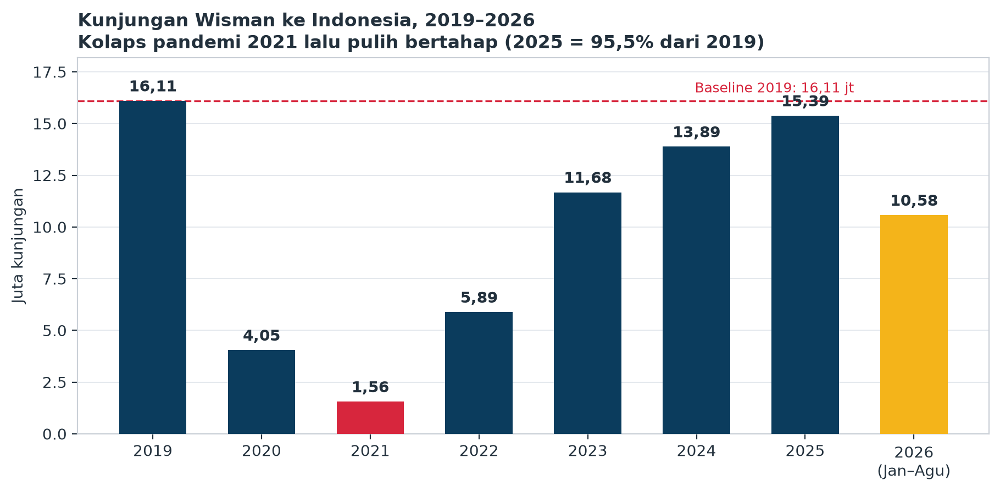
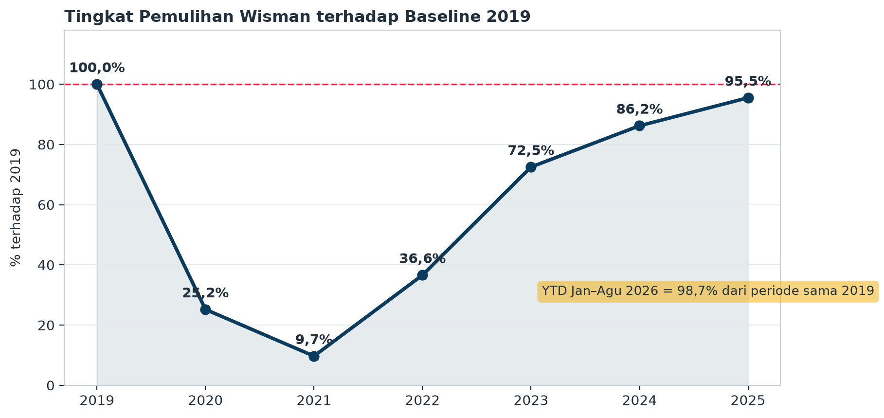
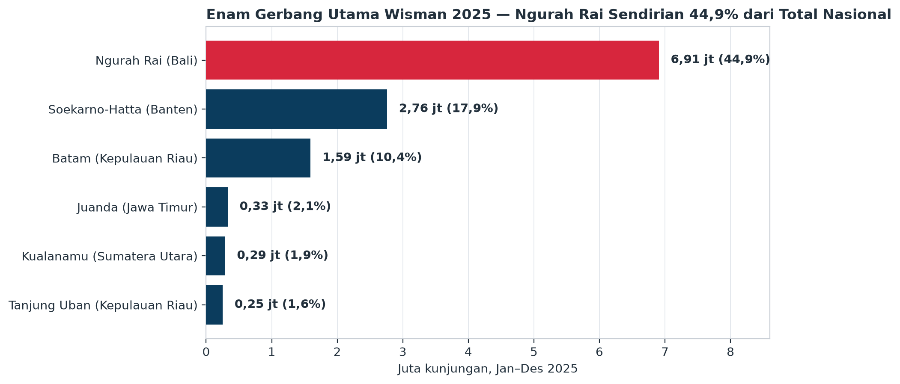
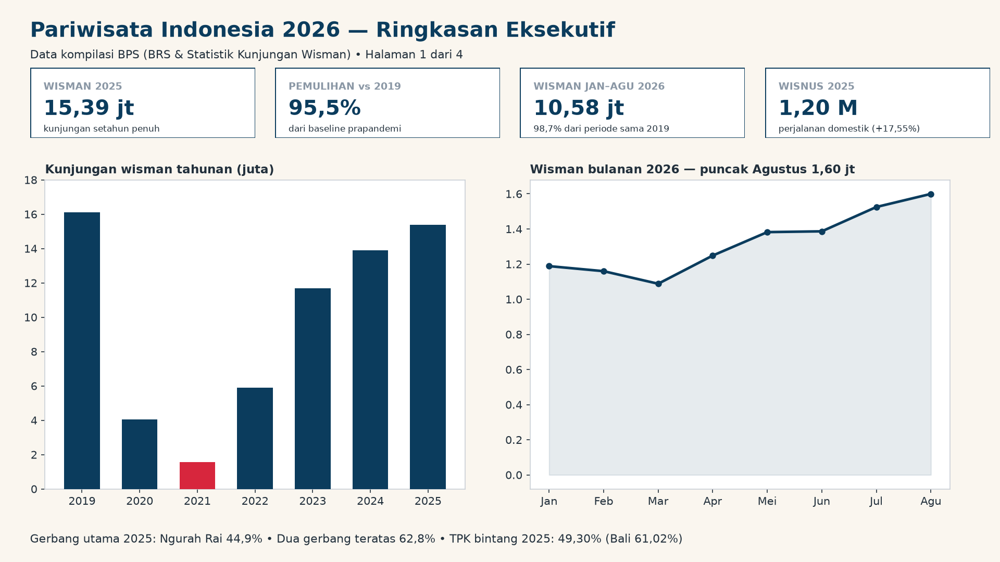

# Pariwisata Indonesia 2026 — Analisis Data Portofolio

Analisis kunjungan wisatawan mancanegara (wisman), tingkat penghunian kamar (TPK)
hotel bintang, dan perjalanan wisatawan nusantara (wisnus) Indonesia periode
**2019 – Agustus 2026**, dikompilasi dari publikasi resmi **Badan Pusat Statistik
(BPS)**. Proyek ini menunjukkan keterampilan kompilasi data dari dokumen publik,
pembersihan dan penataan data, analisis eksploratif, visualisasi, SQL, serta
penyiapan model data untuk Power BI.

## Temuan Utama

- **Pemulihan hampir tuntas.** Wisman 2025 mencapai **15.386.646 kunjungan**
  (naik 10,80% dari 2024), atau **95,5% dari baseline 2019** (16.106.954).
  Kumulatif Jan–Agu 2026 sebesar **10.578.286** kunjungan sudah menyamai
  **98,7%** dari periode yang sama pada 2019.
- **Kolaps pandemi sangat dalam.** Dari 16,11 juta (2019), kunjungan jatuh ke
  4.052.923 (2020) dan titik terendah **1.557.530 (2021)** — hanya 9,7% dari
  baseline — sebelum naik bertangga: 36,6% (2022), 72,5% (2023), 86,2% (2024).
- **Musiman konsisten.** Agustus adalah bulan puncak (indeks musiman 115;
  Agustus 2026 = **1.599.660** kunjungan, tertinggi di 2026), Februari–Maret
  adalah lembahnya.
- **Konsentrasi gerbang ekstrem.** Bandara Ngurah Rai Bali menampung
  **6.907.585 kunjungan (44,9%)** pada 2025. Bersama Soekarno-Hatta
  (2.760.838), dua gerbang menampung **62,8%** dari seluruh wisman; enam
  gerbang utama menampung 78,9%. Gerbang laut Batam menyusul dengan
  1.593.757 kunjungan (10,4%).
- **Pemulihan pasar tidak merata.** Pada 2023 wisatawan Australia sudah
  mencapai **103,2%** dari level 2019, India 92,3%, tetapi Tiongkok baru
  **38,0%** dan Jepang 48,5%. Malaysia tetap pasar nomor satu (pangsa 17,2%
  pada 2025; 18,5% pada Agustus 2026) dan pangsa ASEAN menguat ke 41,3%.
- **TPK bintang menurun.** Rata-rata nasional turun dari 52,57% (2024) ke
  **49,30% (2025)**. Bali tertinggi (**61,02%**), Aceh terendah (25,01%).
  Tamu asing menginap lebih lama daripada tamu Indonesia (2,65 vs 1,46 malam,
  Desember 2025).
- **Domestik adalah raksasa sesungguhnya.** Perjalanan wisnus 2025 mencapai
  **1.200.332.559 perjalanan** (+17,55%), atau **78 kali** kunjungan wisman.
  Tujuan teratas: Jawa Timur (217,2 juta) dan Jawa Barat (211,8 juta);
  64,8% perjalanan bertujuan ke Pulau Jawa.

## Data

Seluruh angka **dikompilasi dari publikasi resmi BPS** (Berita Resmi Statistik
Perkembangan Pariwisata Desember 2024 s.d. Agustus 2026, dan publikasi tahunan
*Statistik Kunjungan Wisatawan Mancanegara 2023*). Tidak ada angka karangan:
setiap seri dapat ditelusuri di [`data/SOURCES.md`](data/SOURCES.md), termasuk
catatan revisi BPS (total 2024: 13.902.420 → 13.886.678), angka final 2022
(5.889.031, menggantikan rilis awal 5,47 juta), serta daftar seri yang
dikecualikan karena tidak dapat diverifikasi (mis. wisman bulanan Jan–Okt 2024).

| Berkas | Isi |
|---|---|
| `data/wisman_tahunan.csv` | Total wisman 2019–2025 + kumulatif Jan–Agu 2026 |
| `data/wisman_bulanan.csv` | Bulanan 2019–2023 lengkap, 2024 (Nov–Des), 2025 (10 bulan), 2026 (Jan–Agu) |
| `data/wisman_pintu_masuk.csv` | 6 gerbang utama × periode (2019, 2023, 2024, 2025, Jan–Agu 2026, Agu 2026) |
| `data/wisman_moda_pintu.csv` | Pangsa moda & kelompok pintu (2019, 2023, 2024, 2025) |
| `data/wisman_kebangsaan.csv` | Tahunan 2019 & 2023, bulanan Des 2025 & Agu 2026 |
| `data/tpk_provinsi.csv` | TPK bintang 38 provinsi: tahunan 2024, 2025, Des 2025 |
| `data/rlm_tamu.csv` | Rata-rata lama menginap Des 2025 & Agu 2026 |
| `data/wisnus_provinsi.csv` | Perjalanan wisnus per provinsi tujuan 2024 & 2025 |

## Struktur Proyek

```
├── README.md
├── findings.json            # semua angka temuan (hasil hitung ulang dari CSV)
├── analysis.ipynb           # notebook analisis
├── Portofolio-Analisis-Pariwisata.pptx
├── Modul-Analisis-Pariwisata.pdf
├── data/                    # CSV kompilasi + SOURCES.md
├── charts/                  # 14 grafik PNG berlabel Bahasa Indonesia
├── scripts/                 # compile_data.py, analysis.py, build_powerbi.py,
│                            # build_ppt.py, build_module.py, build_pbip.py
├── sql/queries.sql          # kueri analitik (SQLite) atas tabel kompilasi
├── powerbi/                 # kit Power BI (star schema + DAX + layout + panduan)
└── pbip/                    # sumber paket PBIP (Report + SemanticModel)
```

## Cara Menjalankan Ulang

```bash
python scripts/compile_data.py   # menulis ulang CSV di data/ dari angka BPS terkompilasi
python scripts/analysis.py       # menghitung findings.json + 14 chart (dengan uji konsistensi internal)
python scripts/build_powerbi.py  # membangun kit di powerbi/ + tabel verifikasi
```

## Visualisasi Utama



*Tren kunjungan wisatawan mancanegara per tahun*



*Kurva pemulihan kunjungan menuju level 2019*



*Kunjungan wisman per pintu masuk utama, 2025*

## Dashboard Power BI



*Pratinjau layout halaman 1 dashboard dari kit di folder `powerbi/`.*

Kit lengkap tersedia di folder [`powerbi/`](powerbi/):

- **Star schema 9 tabel** dengan grain terpisah: `fact_wisman_bulanan`,
  `fact_wisman_tahunan`, `fact_wisman_pintu`, `fact_wisman_kebangsaan`,
  `fact_tpk_provinsi`, `fact_tpk_snapshot`, `fact_rlm`, `fact_wisnus_tujuan`,
  ditambah `dim_bulan` dan `dim_tahun`.
- **14 measure DAX** bernama teks polos (mis. *Total Kunjungan Wisman*,
  *Tingkat Pemulihan vs 2019*, *Pangsa Pintu Masuk*, *Pertumbuhan Wisnus
  Persen*) lengkap dengan **tabel verifikasi** — misalnya pangsa Ngurah Rai
  2025 harus terbaca 44,9% dan total wisnus 2025 harus 1.200.332.559.
- **Layout 4 halaman**: Ringkasan Eksekutif; Pintu Masuk & Kebangsaan;
  Hotel (TPK & Lama Menginap); Wisatawan Nusantara.
- Nama berkas yang disarankan: **Pariwisata-Indonesia-2026.pbix**.
  Panduan langkah demi langkah ada di `powerbi/build_guide.md`.
- **Paket PBIP** juga tersedia sebagai unduhan terpisah
  (`Pariwisata-Indonesia-2026-PBIP.zip`): buka berkas .pbip, arahkan parameter
  FolderData ke folder data paket, refresh, lalu Save As .pbix.

## Metode & Keterbatasan

- Angka tahunan memakai **vintage terbaru** yang diterbitkan BPS; perbedaan
  vintage dicatat di SOURCES.md.
- Nilai bulanan wisman yang semula turunan aritmetika antar kumulatif sudah
  diganti/dikonfirmasi dengan angka eksak BPS per 24 Oktober 2026 (Jan & Feb
  2025 terkoreksi ±34 kunjungan; tiga nilai lain sama persis). Total tahunan
  tidak berubah. Seri bulanan 2025 kini lengkap 12 bulan: Sep & Okt 2025
  dilengkapi 25 Oktober 2026 dari publikasi tahunan BPS 2025, dan jumlah
  ke-12 bulannya persis sama dengan total tahunan resmi 15.386.646.
  Rincian per bulan ada di `data/SOURCES.md`.
- Seri yang tidak dapat diverifikasi dari publikasi BPS **dikecualikan**,
  bukan diestimasi.

## Lisensi & Atribusi

Data © Badan Pusat Statistik (BPS) — digunakan untuk portofolio analisis
dengan atribusi. Kode dan narasi: Baghiz Asshiddiqie Arasya.
